# codeflow

**English** | [简体中文](README.zh-CN.md)

[](https://github.com/PenguinSoul/codeflow/actions/workflows/ci.yml)
[](LICENSE)
[](package.json)

> The human-gated delivery workflow for Claude Code: humans decide, the CLI executes, and every
> pull request carries recorded evidence.

codeflow turns a git repository into a repeatable **human-gated delivery workflow**. It runs a
thin, deterministic execution layer around Claude Code: task-spec, plan,
isolated worktree, gates, evidence, self-review, and a pull request. Claude
supplies judgement, prose, and code. The human keeps trust, design approval,
plan approval, self-review, and merge.

**Status:** early, usable, and deliberately narrow. It does not merge, it does
not auto-approve reviews, and it does not replace CI.

---

## Why

Agent work is easy to start and hard to keep honest:

- State lives in chat, so a reload loses where the work stopped.
- Gates are ad hoc, and the PR body is reconstructed from memory.
- Parallel work collides in one working tree.
- Reviewers see a diff but not the intent, the evidence, the test changes, or
  the places that deserve the closest look.
- Existing tools either automate too much (auto-merge, rubber-stamp review) or
  too little (prompt-only skills with no durable state).

codeflow makes the mechanics deterministic and reviewable:

- **The CLI is the only state owner.** Chat memory is not state.
- **Evidence, not claims.** A gate result exists only if it was run and recorded.
- **Trust is explicit.** Repository-defined commands do not run until a human
  approves the exact config hash.
- **Spec leads the code.** A task starts with a task-spec; durable knowledge must
  return to the repository before the PR.
- **Small tasks, small PRs, one problem.**
- **Fail closed.** Ambiguity, conflicts, and unsafe states stop and escalate.

## The human boundary

| Automated | Human-only |
| --- | --- |
| Task creation and task-spec scaffold | Trust in the gate commands |
| Plan validation | Design approval |
| Worktree and branch creation | Plan approval |
| Gate execution and evidence | Self-review sign-off |
| Attention scanning | Merge |
| PR body, push, and PR creation | Conflict, ambiguity, and security decisions |
| CI observation (read-only) | — |
| Review-comment collection (read-only) | — |
| Status, resume, and cleanup | — |

codeflow never runs `gh pr merge`. The skill forbids it. Review-response
automation (the agent fixes review comments) and autonomous merge are out of scope.

## How it works

```mermaid
flowchart LR
  A[init] --> B[trust]
  B --> C[new]
  C --> D[approve design]
  D --> E[plan]
  E --> F[approve plan]
  F --> G[start / worktree]
  G --> H[verify]
  H --> I[self-review]
  I --> J[approve self-review]
  J --> K[pr]
  K --> L[watch / comments]
  L --> M[human merge]
  M --> N[finish]
```



The task state machine:

```text
created → designed → planned → active → verified → pr_open → merged → done
                         ↘ blocked ↗
```

Every transition is guarded:

- `start` requires a fresh design approval and a fresh plan approval.
- `pr` requires passing, tree-fresh evidence, a clean worktree, and an approved
  self-review.
- Any edit to an approved artifact invalidates the approval by hash.
- A blocked task is resumed explicitly, never retried blindly.

## Features

- **Task-spec first.** Every task gets a short `TASK.md` with Request, Product,
  Design, Durable updates, and Deferrals. The human approves it before code is
  written; `pr` refuses without a durable-updates record.
- **Commit-sized plans.** `plan.json` carries a title, commit subject, and
  verification line per step. The plan is approved by hash over its immutable
  fields; `plan step` records status, summary, and actual result. `pr` requires
  every step to be done.
- **Worktree isolation.** Each task gets a `codeflow/<id>` branch and a worktree
  under `~/.local/state/codeflow/worktrees/<repo>/<task>`. Multiple tasks can run
  in parallel with per-task locks.
- **Trust-bound gates.** `init` detects candidate gates; `trust` shows every
  command and binds approval to the config hash. No trust, no execution.
- **Change-kind inference.** `verify` infers docs, test, infra, or mixed from the
  diff; a mismatch runs the broader gate set. A docs-only task can verify without a
  code gate.
- **Tree-based evidence.** `verify` records command, exit code, duration, logs,
  tree hash, config hash, gate-set hash, and dirty state. A rebase may reuse
  evidence only when the tree is unchanged.
- **Attention scan.** Test-file changes, skipped tests, suppressions, config and
  lockfile changes, and large diffs are scanned. Scope drift and closest-look areas
  are recorded from the self-review flags. They are a spotlight, not an automatic
  verdict.
- **Self-review packet.** Diff stat, plan status, verification table, attention
  items, scope drift, and closest-look areas in one `REVIEW.md`.
- **PR fidelity.** The repository's `PULL_REQUEST_TEMPLATE.md` is preserved;
  checklist items are ticked only when evidence proves them; a `Review
  attention` section is appended when the template lacks one.
- **Rebase before push.** `pr` fetches the base, rebases the task branch, and
  force-pushes with lease after a rewrite. A conflict blocks the task; a changed
  tree invalidates evidence until it is refreshed.
- **Live merge detection.** When `gh` is available, `finish` trusts the actual PR
  state. An open PR is refused even with `--confirm` or `--force`; `--confirm`
  only covers the case where merge detection is unavailable.
- **GitHub optional.** With `gh`, `pr` creates or updates the PR, `watch` reads
  checks, and `comments` reads review threads with their resolution state. Without
  `gh`, `pr` pushes the branch and prints a compare URL.
- **No hidden runtime.** Zero runtime dependencies, no build step, plain Node
  ESM.

## Requirements

- Node.js **>= 20**
- git
- Claude Code
- `gh` *(optional; without it, PR creation falls back to a compare URL)*

WSL/Linux is the first supported platform. The CLI is portable Node, but
Windows-native behavior is not yet a gate.

## Install

Clone the repository:

```bash
git clone https://github.com/PenguinSoul/codeflow.git
cd codeflow
```

Load it as a local plugin:

```bash
claude --plugin-dir .
```

Or install it from this repository as a marketplace:

```text
/plugin install codeflow --marketplace PenguinSoul/codeflow
```

The plugin's `bin/` directory is added to the Bash tool's `PATH` while the
plugin is enabled, so `codeflow` is available directly. You can also run
`./bin/codeflow` from the checkout.

## Quickstart

### From Claude Code

```text
/codeflow:init
/codeflow:trust
/codeflow:new "Fix the login redirect"
/codeflow:approve design
/codeflow:plan
/codeflow:approve plan
/codeflow:start
/codeflow:verify
/codeflow:self-review
/codeflow:approve self-review
/codeflow:pr
```

### From the CLI

```bash
# 1. Detect the repository and write .codeflow/config.json
codeflow init
# commit the config before starting a task
git add .codeflow/config.json && git commit -m "chore: add codeflow config"

# 2. Review every gate command, then approve it
codeflow trust
codeflow trust --yes

# 3. Create a task and fill TASK.md
codeflow new "Fix the login redirect"
# edit .codeflow/state/tasks/<id>/TASK.md
codeflow approve design

# 4. Create and approve the plan
codeflow plan --init
# edit .codeflow/state/tasks/<id>/plan.json
codeflow plan
codeflow approve plan

# 5. Work in an isolated worktree
codeflow start
# implement inside the printed worktree; codeflow commands work from
# the project root or the task worktree

# 6. Record step progress
codeflow plan step 1 --status done \
  --summary "Implemented the redirect guard." \
  --result "`npm test` → pass"

# 7. Verify, review, and ship
codeflow verify
codeflow self-review
codeflow approve self-review
codeflow pr
codeflow watch
codeflow comments

# 7. After the human merges
codeflow finish --confirm
```

Every command supports `--json`.

## Commands

| Command | What it does | Key options |
| --- | --- | --- |
| `init` | Detect the base branch, package manager, and candidate gates | `--force` |
| `trust` | Show and approve the exact gate commands | `--yes` |
| `new <title>` | Create a task and a lightweight task-spec | `--kind`, `--issue` |
| `approve <target>` | Approve `design`, `plan`, or `self-review` by hash | `--by`, `--note` |
| `plan` | Validate and render the step plan; `plan step` records progress | `--init`; `plan step <id> --status --summary --result` |
| `start` | Create the task branch and worktree | `--dry-run` |
| `verify` | Run gates and record tree-hash evidence | `--full`, `--live --allow-live`, `--retry` |
| `self-review` | Build the self-review packet | `--scope-drift`, `--closest-look` |
| `pr` | Render the PR body, rebase onto the base, and create/update the PR; `--no-push` renders only | `--no-push`, `--dry-run` |
| `watch` | Read the PR checks | `--wait`, `--timeout <s>`, `--interval <ms>` |
| `comments` | Collect review comments and resolution state without changing code | — |
| `status` | Show the active task and next step | `--brief`, `--task` |
| `resume` | Clear a blocked state | `--task` |
| `finish` | Verify the merge with `gh`, then remove the worktree; requires an open or merged PR | `--confirm`, `--delete-branch`, `--force` |
| `abandon` | Discard a task that will not ship; refuses an open or merged PR | `--confirm`, `--delete-branch`, `--force` |
| `doctor` | Check the environment and configuration | — |

Global options: `--json`, `--task <id>`, `--help`, `--version`.

### Exit codes

| Code | Meaning |
| --- | --- |
| `0` | Success |
| `1` | A required gate failed or timed out |
| `2` | Usage, config, repository, or schema error |
| `3` | State conflict, stale approval, or lock |
| `4` | Git conflict, dirty tree, or push failure |
| `5` | GitHub/`gh` missing, unauthenticated, or PR conflict |
| `6` | Trust missing or stale |
| `7` | Task blocked; human action required |
| `8` | Unexpected internal failure |

## Artifacts

Committed:

```text
.codeflow/config.json
```

Local, excluded through `.git/info/exclude`:

```text
.codeflow/state/
  active.json
  trust.json
  tasks/<id>/
    task.json
    TASK.md
    plan.json
    PLAN.md
    evidence.json
    EVIDENCE.md
    review.json
    REVIEW.md
    pr.json
    PR_BODY.md
    comments.json
    COMMENTS.md
    events.jsonl
    logs/<gate>.log
```

Worktrees live under `~/.local/state/codeflow/worktrees/<repo>/<task>` by
default. Each task has its own lock; `active.json` is only the default pointer
for commands that omit `--task`.

## Safety

- **Trust is explicit.** `init` never runs a gate. `trust` shows every command and
  binds approval to the exact config hash. State and trust live in the project root;
  a tracked `.codeflow/state` file is refused. A task-branch config needs its own
  approval, and a config change invalidates evidence.
- **Evidence is tree-based.** A rebase may change the commit ID; evidence is reusable
  only when the tree hash, config hash, gate set, and branch match, and the worktree is
  clean. Verification never falls back to the primary checkout.
- **No PR without proof.** `pr` requires a task worktree on `task.branch`, passing
  evidence, a clean tree, fresh design/plan approvals, an approved self-review whose
  hash matches the packet, and a PR head equal to the verified HEAD. `--no-push` only
  renders the body. `verify` may be re-run on a `verified` task to refresh evidence.
- **No merge.** There is no merge command. The skill forbids `gh pr merge`.
- **No false green.** A repository with no checks reports `none`, never success.
- **No forced finish of an open PR.** `finish --force` only bypasses a dirty
  worktree. When `gh` reports the PR open, `finish` refuses regardless of
  `--confirm` or `--force`; a `gh` auth or network failure is blocked, not treated as
  absent merge detection.
- **No gate weakening.** The skill forbids editing tests, adding skips, or adding
  `@ts-ignore`, `@ts-expect-error`, `eslint-disable`, `biome-ignore`, or `as any`
  to make a gate pass.
- **No token storage.** `gh` owns GitHub auth. codeflow stores no credentials.
- **Logs are local.** Gate logs may contain secrets printed by the project's own
  tools. They are never uploaded.

## Repository layout

```text
bin/codeflow              executable entry
src/                      deterministic CLI modules
commands/                 Claude Code slash commands
skills/codeflow/          workflow policy and red lines
hooks/                    SessionStart status injection
test/                     node:test suites, fake gates, fake gh
docs/                     goal, architecture, contracts, design
.github/workflows/ci.yml  Node 20/22 tests and syntax checks
```

## Design docs

- [`docs/goal-and-requirements.md`](docs/goal-and-requirements.md) — product goal,
  human boundary, non-goals, success metrics.
- [`docs/architecture.md`](docs/architecture.md) — topology, numbered decisions,
  invariants, trust, evidence, safety.
- [`docs/contracts.md`](docs/contracts.md) — the JSON wire and every artifact
  schema.
- [`docs/DESIGN.md`](docs/DESIGN.md) — the integrated design and implementation
  order.

## Development

```bash
npm test                  # 111 tests: temporary repos, fake gates, fake gh
npm run check             # node --check on every source file
claude plugin validate .  # manifest, commands, hooks, marketplace
```

CI runs `npm test` and `npm run check` on Node 20 and 22.

Known limits:

- No real GitHub calls in tests; the real PR path is a manual smoke test.
- No screenshot automation; the PR body leaves an explicit placeholder.
- No MCP adapter, issue-tracker sync, multi-repo orchestration, web UI, or task
  garbage collection.
- Windows-native behavior is not yet a CI gate.

## Contributing

- **Micro changes** — docs, README, typos, comments, formatting, license, and
  small non-behavioral config — may be committed directly to `main`. No PR is
  required.
- **Behavior, contracts, dependencies, security, CI, and release changes** use a
  focused PR with the verification below.
- Keep one problem per change.
- Run `npm test`, `npm run check`, and `claude plugin validate .`.
- Do not add suppressions, weaken tests, or skip a human gate.
- Include before/after screenshots for user-visible UI changes.

## License

MIT. See [`LICENSE`](LICENSE).
