# claude-codeflow

[English](README.md) | **简体中文**

[](https://github.com/PenguinSoul/claude-codeflow/actions/workflows/ci.yml)
[](LICENSE)
[](package.json)

claude-codeflow 是一个为了增强 Agent First 仓库而开发的软件工程流程插件。

它把一个任务从一段简短的 spec，带到 plan、隔离的 worktree、项目检查、self-review，最后开一个 PR。Claude 负责读代码、写代码；你负责批准 design、plan、self-review 和 merge。真正跑过的检查会留在磁盘上，PR 描述从这些记录生成，而不是靠 agent 回忆。

它不是 coding agent，也不会 merge。它是 agent 工作外面那层有点无聊、但需要有人认真做的文书工作。

**状态：** 早期可用，刻意做得很小。目前主要支持 WSL/Linux；Node 20 以上。

## 为什么做这个

用 agent 改真实仓库时，我反复遇到这些问题：

- 刷新一下，没人知道任务做到哪了。
- 检查是 agent 想起什么跑什么。
- PR 描述是凭记忆写的，不是从结果来的。
- 两个 agent 在同一个工作区里互相踩。
- reviewer 看得到 diff，但看不到验证了什么、改了哪些测试、哪里最该先看。

claude-codeflow 把任务状态放到磁盘上，给每个任务一个独立 worktree，把 gate 命令摆到明面上，再把结果带进 PR。

## 哪些事仍然由你决定

1. claude-codeflow 可以运行哪些命令。
2. 写代码前的 task-spec。
3. 计划。
4. self-review 包。
5. 合并。

claude-codeflow 不 merge，不 approve PR，也不会把“没跑”的检查写成“通过”。

## 流程

```mermaid
flowchart LR
  A[init] --> B[trust]
  B --> C[new]
  C --> D[approve design]
  D --> E[plan]
  E --> F[approve plan]
  F --> G[start / worktree]
  G --> H[verify]
  H --> I[self-review]
  I --> J[approve self-review]
  J --> K[pr]
  K --> L[watch / comments]
  L --> M[你合并]
  M --> N[finish]
```



任务状态是 `created → designed → planned → active → verified → pr_open →
done`。rebase 冲突会让任务变成 `blocked`，等你处理；`resume` 回到之前的状态。
gate 失败时任务保持 `active`，修好后重新 verify。task worktree 丢失时，
`codeflow start` 会在任务分支上重建它，并保留 `verified` 或 `pr_open` 状态。
它不会自己重试，也不会自己解冲突。

## 一个任务里有什么

- **`TASK.md`**：Request、Product、Design、Durable updates、Deferrals。写代码前由人批准。`pr` 要求有耐久更新记录，避免任务做完、仓库什么都没学到。
- **`plan.json`**：按 commit 粒度的步骤，每步有标题、commit subject 和计划中的检查。批准只覆盖这些不可变字段；`plan step` 记录状态、总结和实际结果，`pr` 要求所有步骤都完成。标记 done 时必须给结果，不能只打个勾。
- **任务 worktree**：`codeflow/<id>` 分支，加上 `~/.local/state/codeflow/worktrees/<repo>/<task>` 下的独立工作树。任务的树就是要交付的树；claude-codeflow 不会退回去验证你的主 checkout。
- **`evidence.json`**：跑了哪些 gate、退出码、耗时、日志、tree hash、config hash、gate-set hash、分支和 dirty 状态。rebase 之后，只有树没变才可复用。
- **`REVIEW.md`**：diff stat、计划状态、验证结果、风险项、scope drift 和最该重点看的地方，集中在一份包里。
- **`PR_BODY.md`**：从 task-spec、plan、evidence 和仓库自己的 PR 模板生成。

这些都放在 `.codeflow/state/` 下，属于本地状态，通过 `.git/info/exclude` 排除。state 和 trust 属于项目根目录，被验证的 config 来自任务 worktree。如果 `.codeflow/state` 被 git 跟踪，所有命令都会拒绝运行。

## 环境要求

- Node.js 20 或更新
- git
- Claude Code
- `gh`：可选；没有它时，`pr` 会推分支并打印 compare URL

## 安装

```bash
git clone https://github.com/PenguinSoul/claude-codeflow.git
cd claude-codeflow
claude --plugin-dir .
```

或者从仓库作为 marketplace 安装：

```text
/plugin install codeflow --marketplace PenguinSoul/claude-codeflow
```

实测 Claude Code 2.1.278 不会把插件的 `bin/` 加入 Bash 工具的 `PATH`，所以命令统一通过
`${CLAUDE_PLUGIN_ROOT}` 调用 CLI，授权规则也只匹配这个路径。不需要额外 export 任何东西。

想在 Claude Code 之外手动调用，直接用检出目录或安装缓存里的可执行文件：

```bash
/path/to/codeflow/bin/codeflow --version
```

## 快速开始

在 Claude Code 里：

```text
/codeflow:init
/codeflow:trust
/codeflow:new "修复登录重定向"
/codeflow:approve design
/codeflow:plan
/codeflow:approve plan
/codeflow:start
/codeflow:verify
/codeflow:self-review
/codeflow:approve self-review
/codeflow:pr
```

在 CLI 里：

```bash
# 1. 写 config，并在 start 之前提交它
codeflow init
git add .codeflow/config.json && git commit -m "chore: add codeflow config"

# 2. 看清楚要跑哪些命令，再批准
codeflow trust
codeflow trust --yes

# 3. 建任务，填 .codeflow/state/tasks/<id>/TASK.md
codeflow new "修复登录重定向"
codeflow approve design

# 4. 写计划，再批准
codeflow plan --init
# 编辑 .codeflow/state/tasks/<id>/plan.json
codeflow plan
codeflow approve plan

# 5. 在任务 worktree 里干活
codeflow start

# 6. 记录每一步实际做了什么
codeflow plan step 1 --status done \
  --summary "加了重定向保护。" \
  --result "npm test -> pass"

# 7. 验证、自审、开 PR
codeflow verify
codeflow self-review
codeflow approve self-review
codeflow pr

# 8. 用 GitHub 的话，看 CI 和 review 线程
codeflow watch
codeflow comments

# 9. 你合并之后
codeflow finish
```

所有命令都支持 `--json`。

`--dry-run` 由 `init`、`new`、`start`、`verify`、`pr`、`finish` 和 `abandon` 实现。
其他命令会直接拒绝该 flag，而不是静默忽略。

## 命令

| 命令 | 作用 | 常用选项 |
| --- | --- | --- |
| `init` | 探测 base branch、包管理器和候选 gate | `--force` |
| `trust` | 展示精确的 gate 命令并记录批准 | `--yes` |
| `new <title>` | 创建任务和 task-spec | `--kind`、`--issue` |
| `approve <target>` | 按 hash 批准 `design`、`plan` 或 `self-review` | `--by`、`--note` |
| `plan` | 校验并渲染计划；`plan step` 记录进度 | `plan step <id> --status --summary --result` |
| `start` | 创建任务分支和 worktree | `--dry-run` |
| `verify` | 跑 gate，记录证据 | `--full`、`--live --allow-live`、`--retry` |
| `self-review` | 生成 self-review 包 | `--scope-drift`、`--closest-look` |
| `pr` | rebase、渲染 body、推送并创建/更新 PR | `--no-push`、`--dry-run` |
| `watch` | 读 PR checks 和 merge 状态 | `--wait`、`--timeout <s>`、`--interval <ms>` |
| `comments` | 读 review 线程及解决状态 | — |
| `status` | 看当前任务和下一步 | `--brief`、`--task` |
| `resume` | 问题解决后继续 blocked 任务 | `--task` |
| `finish` | 验证合并，然后删 worktree | `--confirm`、`--delete-branch`、`--force` |
| `abandon` | 丢弃不会交付的任务 | `--confirm`、`--delete-branch`、`--force` |
| `doctor` | 检查 git、hooks、gh、登录、worktree 根目录、state、schema 和锁 | — |

全局选项：`--json`、`--task <id>`、`--help`、`--version`。

### 退出码

| 退出码 | 含义 |
| --- | --- |
| `0` | 成功 |
| `1` | 必需 gate 失败或超时 |
| `2` | 用法、配置、仓库或 schema 错误 |
| `3` | 状态冲突、批准过期或锁 |
| `4` | Git 冲突、工作区不干净或 push 失败 |
| `5` | GitHub/`gh` 缺失、未登录或 PR 冲突 |
| `6` | 信任缺失或过期 |
| `7` | 任务 blocked，需要人处理 |
| `8` | 非预期的内部错误 |

## 安全，直说

- Gate 命令就是代码。`init` 不会执行它们；`trust` 展示每一条，并把批准绑定到精确的 config hash。任务分支改了 config，就要单独批准那个 config。
- 证据绑定到 tree、config、gate set 和分支。`pr` 会检查 worktree 是否在任务分支上、PR head 是否等于已验证的 HEAD。rebase 改了树，就重新 verify。
- `.codeflow/state` 是本地状态。如果它被 git 跟踪，claude-codeflow 直接拒绝运行，不会信任仓库带来的 state。
- 仓库没有 checks 时报告 `none`，不是 success。pending 或无法判断，也不是绿。
- `finish` 要求任务有已开或已合并的 PR，并在 `gh` 报告 PR 仍为 open 时拒绝。不会交付的任务用 `abandon`。`--force` 只绕过 dirty worktree，不绕过合并检查。
- `gh` 装了但没登录时，交付会失败。它不会悄悄退回 compare URL，`finish` 也不会把失败当成“没有 PR”。
- claude-codeflow 不存 token，GitHub 认证归 `gh`。Gate 日志只在本机，里面可能有项目自己打印的敏感信息。
- 没有 merge 命令。skill 明确禁止 `gh pr merge`。

## 产物

会提交到仓库：

```text
.codeflow/config.json
```

本地状态，通过 `.git/info/exclude` 排除：

```text
.codeflow/state/
  active.json
  trust.json
  state.lock
  tasks/<id>/
    task.json
    TASK.md
    plan.json
    PLAN.md
    evidence.json
    EVIDENCE.md
    review.json
    REVIEW.md
    pr.json
    PR_BODY.md
    comments.json
    COMMENTS.md
    events.jsonl
    lock
    logs/<gate>.log
```

worktree 默认在 `~/.local/state/codeflow/worktrees/<repo>/<task>`。每个任务有自己的锁；`active.json` 只是省略 `--task` 时的默认指针，任务在 `finish` 或 `abandon` 收尾后会被清掉。

建议把 `worktreeRoot` 设为仓库内的路径（如 `.worktrees`）：主仓库和任务 worktree 在同一文件系统内，相对路径也按主仓库根解析；记得把该目录加入 `.gitignore`。

## 更多细节

设计文档在 [`docs/`](docs/)：

- [`goal-and-requirements.md`](docs/goal-and-requirements.md)：claude-codeflow 是什么、不是什么。
- [`architecture.md`](docs/architecture.md)：状态模型背后的决策和不变量。
- [`contracts.md`](docs/contracts.md)：JSON 形状和错误码。
- [`DESIGN.md`](docs/DESIGN.md)：整合后的设计与实现顺序。

## 开发

```bash
npm test                  # 130 个测试：临时仓库、fake gate、fake gh
npm run check             # 对每个源文件执行 node --check
claude plugin validate .  # manifest、commands、hooks、marketplace
```

CI 在 Node 20 和 22 上跑 `npm test` 和 `npm run check`。测试不联网；真实 GitHub 路径用私有仓库做过手动 smoke。

已知限制：

- 没有截图自动化；PR body 会留占位符。
- 没有 MCP adapter、issue tracker 同步、多仓库编排、Web UI 或任务 GC。
- 目前只有 schema v1；迁移会等第一次版本升级时再做。
- Windows 原生行为还没有作为 CI gate；测试套件已可移植并在 Windows 11 上验证，
  但 CI 仍只跑 Linux。
- CLI 会检查 PR 状态，但不强制独立 reviewer；那仍然取决于你的仓库设置。

## 贡献

`main` 已开启分支保护。所有改动都通过 PR，并跑 Node 20/22 的检查；文档类 PR 可以很小。开 PR 前请跑 `npm test`、`npm run check` 和 `claude plugin validate .`。不要为了让改动通过而弱化测试或跳过人工闸。

## 许可证

MIT。见 [`LICENSE`](LICENSE)。
