# codeflow

[English](README.md) | **简体中文**

[](https://github.com/PenguinSoul/codeflow/actions/workflows/ci.yml)
[](LICENSE)
[](package.json)

> Claude Code 的 L1 工作流：人做决定，CLI 执行，每个 Pull Request 都带着可复核的证据。

codeflow 把一个 git 仓库变成可重复的 **L1 工作流**。它在 Claude Code 外面套了一层薄而确定的执行层：task-spec、计划、隔离工作树、门禁、证据、自审和 Pull Request。Claude 负责判断、文字和代码；人保留信任、设计批准、计划批准、自审和合并。

**状态：** 早期、可用、刻意收窄。它不合并 PR，不自动批准 review，也不替代 CI。

---

## 为什么需要它

Agent 干活很容易开始，却很难保持诚实：

- 状态活在聊天里，刷新一下就不知道做到哪了。
- 门禁是临时想起来跑的，PR 描述靠回忆拼出来。
- 并行任务挤在同一个工作区里互相踩。
- Reviewer 看得到 diff，却看不到意图、证据、测试改动，以及最该重点看的地方。
- 现有工具要么管得太多（自动合并、橡皮图章 review），要么管得太少（只有 prompt，没有持久状态）。

codeflow 把机械部分做成确定、可复核的：

- **CLI 是唯一的状态所有者。** 聊天记忆不是状态。
- **要证据，不要声明。** 门禁结果只存在于真正跑过并记录下来的地方。
- **信任必须显式。** 仓库里定义的命令，在人批准精确的 config hash 之前不会执行。
- **Spec 先于代码。** 任务从 task-spec 开始；耐久知识必须在 PR 之前回到仓库。
- **小任务、小 PR、一个问题。**
- **失败即停。** 歧义、冲突和不安全状态会停下来交给人。

## L1 边界

| 自动执行 | 仅由人完成 |
| --- | --- |
| 创建任务和 task-spec 脚手架 | 信任门禁命令 |
| 校验计划 | 批准设计 |
| 创建分支和工作树 | 批准计划 |
| 执行门禁、记录证据 | 自审签字 |
| 风险扫描 | 合并 |
| 渲染 PR 描述、push、创建 PR | 冲突、歧义和安全决策 |
| 只读观察 CI | — |
| 只读收集 review 评论 | — |
| 状态、恢复和清理 | — |

codeflow 永远不会执行 `gh pr merge`，skill 里也明确禁止。L2（agent 按 review 评论改代码）和 L3（自主合并）不在范围内。

## 工作方式

```mermaid
flowchart LR
  A[init] --> B[trust]
  B --> C[new]
  C --> D[approve design]
  D --> E[plan]
  E --> F[approve plan]
  F --> G[start / worktree]
  G --> H[verify]
  H --> I[self-review]
  I --> J[approve self-review]
  J --> K[pr]
  K --> L[watch / comments]
  L --> M[human merge]
  M --> N[finish]
```



任务状态机：

```text
created → designed → planned → active → verified → pr_open → merged → done
                         ↘ blocked ↗
```

每个状态转换都有守卫：

- `start` 需要未过期的设计批准和计划批准。
- `pr` 需要通过且对当前树有效的证据、干净的工作区、已批准的自审。
- 已批准产物一旦被修改，批准就会因 hash 不匹配而失效。
- blocked 任务必须显式 `resume`，不会被盲目重试。

## 功能

- **Task-spec 先行。** 每个任务都有一份简短的 `TASK.md`，包含 Request、Product、Design、Deferrals；人批准后才写代码。
- **按 commit 粒度的计划。** `plan.json` 的每一步都有标题、commit subject 和验证方式；计划经校验后按 hash 批准。
- **工作树隔离。** 每个任务有 `codeflow/<id>` 分支，以及 `~/.local/state/codeflow/worktrees/<repo>/<task>` 下的独立工作树。多个任务可以并行，每个任务有自己的锁。
- **信任绑定的门禁。** `init` 只探测候选门禁；`trust` 展示每条命令，并把批准绑定到 config hash。没有信任就不执行。
- **基于树的证据。** `verify` 记录命令、退出码、耗时、日志、tree hash、config hash、gate-set hash 和 dirty 状态。rebase 之后，只有树没变才可复用证据。
- **风险扫描。** 测试文件改动、被跳过的测试、suppression、配置和锁文件改动、大 diff、scope drift、closest look 都会摆到人面前。它是探照灯，不是自动判决。
- **自审包。** `REVIEW.md` 里集中呈现 diff stat、计划状态、验证表、风险项、scope drift 和最该重点看的地方。
- **PR 模板保真。** 保留仓库的 `PULL_REQUEST_TEMPLATE.md`；只有证据能证明的 checklist 项才会打勾；模板没有 `Review attention` 时自动追加。
- **GitHub 可选。** 有 `gh` 时，`pr` 创建或更新 PR，`watch` 读 checks，`comments` 读 review 线程；没有 `gh` 时，`pr` 推分支并打印 compare URL。
- **没有隐藏运行时。** 零运行时依赖，无构建步骤，纯 Node ESM。

## 环境要求

- Node.js **>= 20**
- git
- Claude Code
- `gh` *（可选；没有它时 PR 创建降级为 compare URL）*

WSL/Linux 是第一支持平台。CLI 本身是可移植的 Node 代码，但 Windows 原生行为还没有作为门禁。

## 安装

克隆仓库：

```bash
git clone https://github.com/PenguinSoul/codeflow.git
cd codeflow
```

作为本地插件加载：

```bash
claude --plugin-dir .
```

或者从本仓库作为 marketplace 安装：

```text
/plugin install codeflow --marketplace PenguinSoul/codeflow
```

插件启用期间，它的 `bin/` 会加入 Bash 工具的 `PATH`，所以可以直接运行 `codeflow`。也可以在 checkout 里直接跑 `./bin/codeflow`。

## 快速开始

### 在 Claude Code 里

```text
/codeflow:init
/codeflow:trust
/codeflow:new "修复登录重定向"
/codeflow:approve design
/codeflow:plan
/codeflow:approve plan
/codeflow:start
/codeflow:verify
/codeflow:self-review
/codeflow:approve self-review
/codeflow:pr
```

### 在 CLI 里

```bash
# 1. 探测仓库，写入 .codeflow/config.json
codeflow init

# 2. 逐条 review 门禁命令，然后批准
codeflow trust
codeflow trust --yes

# 3. 创建任务并填写 TASK.md
codeflow new "修复登录重定向"
# 编辑 .codeflow/state/tasks/<id>/TASK.md
codeflow approve design

# 4. 创建并批准计划
codeflow plan --init
# 编辑 .codeflow/state/tasks/<id>/plan.json
codeflow plan
codeflow approve plan

# 5. 在隔离的工作树里实现
codeflow start
# 在打印出的 worktree 里写代码

# 6. 验证、自审、交付
codeflow verify
codeflow self-review
codeflow approve self-review
codeflow pr
codeflow watch
codeflow comments

# 7. 人合并之后清理
codeflow finish --confirm
```

所有命令都支持 `--json`。

## 命令

| 命令 | 作用 | 常用选项 |
| --- | --- | --- |
| `init` | 探测 base branch、包管理器和候选门禁 | `--force` |
| `trust` | 展示并批准精确的门禁命令 | `--yes` |
| `new <title>` | 创建任务和轻量 task-spec | `--kind`、`--issue` |
| `approve <target>` | 按 hash 批准 `design`、`plan` 或 `self-review` | `--by`、`--note` |
| `plan` | 校验并渲染计划 | `--init` |
| `start` | 创建任务分支和工作树 | `--dry-run` |
| `verify` | 跑门禁并记录基于树的证据 | `--full`、`--live --allow-live`、`--retry` |
| `self-review` | 生成自审包 | `--scope-drift`、`--closest-look` |
| `pr` | 渲染 PR 描述并创建/更新 PR | `--no-push`、`--dry-run` |
| `watch` | 只读查看 PR checks | `--wait` |
| `comments` | 只读收集 review 评论，不改代码 | — |
| `status` | 查看当前任务和下一步 | `--brief`、`--task` |
| `resume` | 清除 blocked 状态 | `--task` |
| `finish` | 合并后移除工作树 | `--confirm`、`--delete-branch`、`--force` |
| `doctor` | 检查环境和配置 | — |

全局选项：`--json`、`--task <id>`、`--help`、`--version`。

### 退出码

| 退出码 | 含义 |
| --- | --- |
| `0` | 成功 |
| `1` | 必需门禁失败或超时 |
| `2` | 用法、配置、仓库或 schema 错误 |
| `3` | 状态冲突、批准过期或锁 |
| `4` | Git 冲突、工作区不干净或 push 失败 |
| `5` | GitHub/`gh` 缺失、未登录或 PR 冲突 |
| `6` | 信任缺失或过期 |
| `7` | 任务 blocked，需要人处理 |
| `8` | 非预期的内部错误 |

## 产物

会提交到仓库：

```text
.codeflow/config.json
```

本地状态，通过 `.git/info/exclude` 排除：

```text
.codeflow/state/
  active.json
  trust.json
  tasks/<id>/
    task.json
    TASK.md
    plan.json
    PLAN.md
    evidence.json
    EVIDENCE.md
    review.json
    REVIEW.md
    pr.json
    PR_BODY.md
    comments.json
    COMMENTS.md
    events.jsonl
    logs/<gate>.log
```

工作树默认在 `~/.local/state/codeflow/worktrees/<repo>/<task>`。每个任务有自己的锁；`active.json` 只是省略 `--task` 时的默认指针。

## 安全模型

- **信任必须显式。** `init` 从不执行门禁。`trust` 展示每条命令，并把批准绑定到规范化后的 config hash。配置一变，信任和证据都失效。
- **证据基于树。** rebase 可能改变 commit ID；只有 tree hash、config hash、gate set 全部匹配，并且工作区干净时，证据才可复用。
- **没有证据不能开 PR。** `pr` 需要通过且未过期的证据、干净的工作区、新鲜的设计/计划批准，以及已批准的自审。
- **没有合并。** 不存在 merge 命令；skill 明确禁止 `gh pr merge`。
- **不许弱化门禁。** skill 禁止为了让门禁通过而改测试、加 skip，或加 `@ts-ignore`、`@ts-expect-error`、`eslint-disable`、`biome-ignore`、`as any`。
- **不存 token。** GitHub 认证归 `gh` 管，codeflow 不保存任何凭证。
- **日志只在本机。** 门禁日志可能包含项目工具打印出的敏感信息，永远不会被上传。

## 仓库结构

```text
bin/codeflow              可执行入口
src/                      确定性的 CLI 模块
commands/                 Claude Code slash commands
skills/codeflow/          L1 策略和红线
hooks/                    SessionStart 状态注入
test/                     node:test 测试、fake gate、fake gh
docs/                     目标、架构、契约、设计
.github/workflows/ci.yml  Node 20/22 测试和语法检查
```

## 设计文档

- [`docs/goal-and-requirements.md`](docs/goal-and-requirements.md) — 产品目标、L1 边界、非目标、成功指标。
- [`docs/architecture.md`](docs/architecture.md) — 拓扑、编号决策、不变量、信任、证据、安全。
- [`docs/contracts.md`](docs/contracts.md) — JSON wire 和所有产物 schema。
- [`docs/DESIGN.md`](docs/DESIGN.md) — 整合后的设计与实现顺序。

## 开发

```bash
npm test                  # 80 个测试：临时仓库、fake gate、fake gh
npm run check             # 对每个源文件执行 node --check
claude plugin validate .  # manifest、commands、hooks、marketplace
```

CI 在 Node 20 和 22 上运行 `npm test` 和 `npm run check`。

已知限制：

- 测试不调用真实 GitHub；真实 PR 路径需要手动 smoke。
- 没有截图自动化；PR 描述里会留显式占位符。
- 没有 MCP adapter、issue tracker 同步、多仓库编排、Web UI 或任务 GC。
- Windows 原生行为还没有作为 CI 门禁。

## 贡献

1. 先开 issue，或者描述你实际遇到的问题。
2. 保持改动聚焦；一个 PR 只解决一个问题。
3. 运行 `npm test`、`npm run check` 和 `claude plugin validate .`。
4. 不要加 suppression、弱化测试、跳过人工闸。
5. 用户可见的 UI 改动请附 before/after 截图。

## 许可证

MIT。见 [`LICENSE`](LICENSE)。
